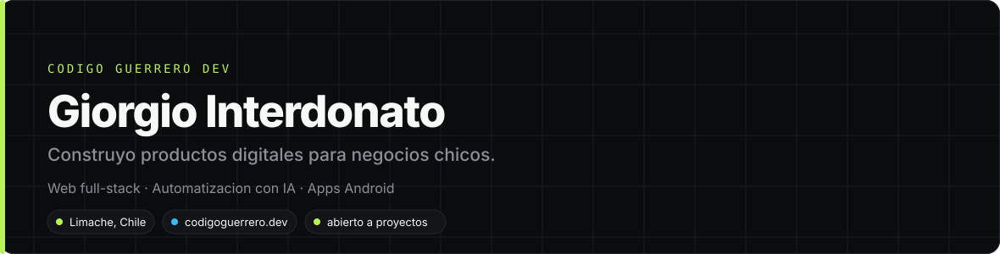
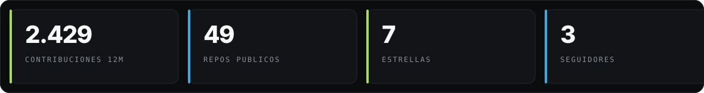
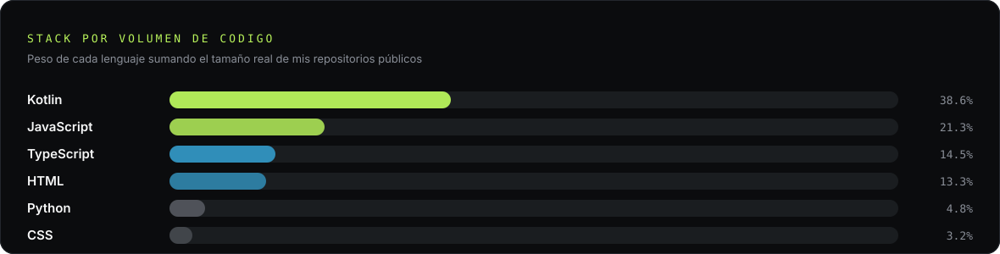
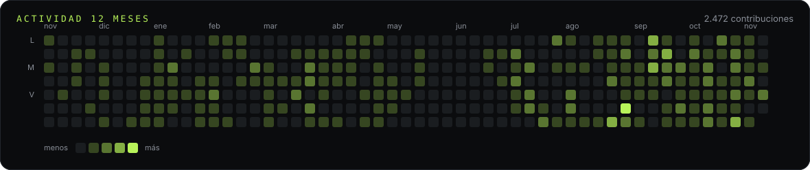

**Construyo productos digitales para negocios chicos.** Vengo de la comunicación, no de la informática: aprendí a programar resolviendo problemas reales de pymes y llevo desde entonces un estudio con sitios vivos atendiendo clientes.

[codigoguerrero.dev](https://codigoguerrero.dev) · [CV](https://cv.codigoguerrero.dev) · [Repositorios](https://github.com/DonGeeo87?tab=repositories)

## Qué hago

- **Web full-stack**: React + Vite, Node/Express, Postgres. Sitios de cliente, catálogos con constructor visual, reservas online, pagos y paneles de administración.
- **Automatización con IA**: agentes autónomos en servidor propio para atención por WhatsApp y Telegram, prospección y generación de contenido. En producción, no en pruebas.
- **Contenido programático y SEO**: sitios con prerenderizado, arquitectura de contenidos y publicación automatizada. Diseño, despliego y mido.
- **Apps móviles**: Kotlin + Jetpack Compose + Firebase. Formado en 2025 con 480 horas de Android y 100% de asistencia.

## Stack

## Lo que estoy construyendo

| Producto | Qué es |
|---|---|
| [midiario.codigoguerrero.dev](https://midiario.codigoguerrero.dev) | Periódico personal: cada día el lector recibe un diario armado con sus temas. Plantillas, generación asistida, validación editorial y publicación automática. |
| [asistente.codigoguerrero.dev](https://asistente.codigoguerrero.dev) | Asistentes de IA para pequeños negocios: responden consultas, toman pedidos y agendan citas por mensajería. Con panel y planes por suscripción. |
| Konekta | Plataforma para emprendedores: captar clientes y vender más allá del evento. Todavía en pañales, con la app Android como primer paso. |

## Sitios de clientes en producción

| Sitio | Qué es |
|---|---|
| [vivaresource.com](https://www.vivaresource.com) | Viva Resource Foundation: sitio bilingüe con panel de contenidos y donaciones. Nuestro cliente estrella. |
| [jessvitrofusion.art](https://jessvitrofusion.art) | Vitrofusión: catálogo con constructor visual de productos, gestor de pedidos y chat de atención por WhatsApp. |
| [legadobarber.hair](https://legadobarber.hair) | Barbería: reservas online, panel de administración y avisos automáticos por WhatsApp y correo. |
| [laplazasedella.bar](https://laplazasedella.bar) | Bar y restaurante: sistema de gestión completo. |
| [tofitastudio.com](https://tofitastudio.com) | Tienda con MercadoPago Checkout Pro, portafolio y newsletter. |
| [codigoguerrero.dev](https://codigoguerrero.dev) | El portal de mi estudio, que uso como laboratorio de SEO y publicación automatizada. |

## Código público

| Repo | Qué es |
|---|---|
| [la-fabrica](https://github.com/DonGeeo87/la-fabrica) | Agentes autónomos que generan leads y contenido para un negocio. |
| [TypingQuest](https://github.com/DonGeeo87/TypingQuest) | Juego de mecanografía (MIT). |
| [Guia-de-Formalizacion-Chile](https://github.com/DonGeeo87/Guia-de-Formalizacion-Chile) | Guía de formalización de SPA, hecha para un cliente real. |
| [cg-shell-janitor](https://github.com/DonGeeo87/cg-shell-janitor) | Cierra procesos que quedan vivos tras su comando en Windows (~140 MB cada uno). |
| [Portafolio-Personal](https://github.com/DonGeeo87/Portafolio-Personal) | Mi portafolio. |

## Cómo llegué acá

Comunicación audiovisual y administración de personas en Duoc UC, diez años gestionando proyectos, programas sociales y campañas. En 2025 hice la formación de Android del SENCE (480 horas) y desde entonces construyo lo que antes encargaba. La IA generativa la aprendí de autodidacta, igual que el resto: leyendo, rompiendo cosas y midiendo si funcionó.

¿Tienes un proyecto en mente? Hablemos en <a href="https://codigoguerrero.dev">codigoguerrero.dev</a>.

<!-- Los gráficos son SVG generados desde la API de GitHub con scripts/generate.py y se refrescan solos cada día vía GitHub Actions. Sin servicios de terceros ni temas de pago. -->
